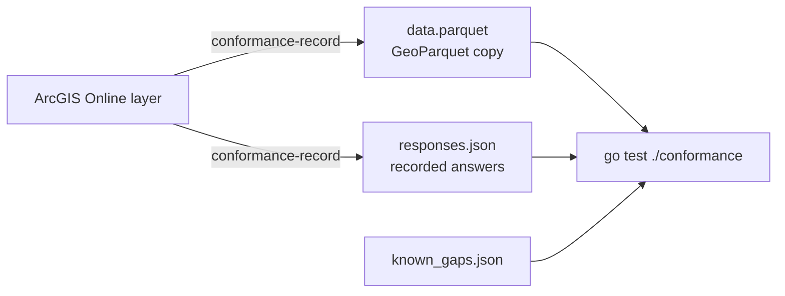

# Conformance testing

The conformance suite compares this server with real ArcGIS Online FeatureServer layers. It finds
where the answers differ, and it fails when a new difference appears or a known one goes away.

## How it works



1. For each reference layer, the recorder (`cmd/conformance-record`) makes a GeoParquet copy of
   its features. The copy keeps the object ids as `feature_id`, uses the Esri field types and
   stores EPSG:4326 at full precision.
2. The recorder sends each request in `testdata/conformance/requests.json` to the reference layer
   and saves the answers.
3. The test serves the copy with the server's default limits and the reference layer's page
   sizes, sends the same requests, and compares the answers.

The comparison ignores row order unless the request sets an order. Numbers match within a
tolerance. Each difference is reported as a path and a kind, for example
`features[].attributes.Measure (value)`. The kinds are `missing`, `extra`, `value`, `length` and
`order`.

## Known gaps

Every difference must match an entry in a known gaps file, with a reason:

- `testdata/conformance/known_gaps.json` for the small tier
- `testdata/conformance/known_gaps_large.json` for the large tier

Each file has two lists. `ignore` holds differences that do not matter to clients, such as free
text in error messages or capabilities that the server does not implement. `known` holds real
differences in behavior. An entry that no longer matches any difference also fails the test, so
the lists stay current when a fix lands.

To fix a gap, change the server, then remove its entry.

## Tiers

| Tier | Layers | Where the data is | When it runs |
|---|---|---|---|
| Small | Three public layers from the Utah SGID: a point, a line and a polygon layer | `testdata/conformance/layers/` in git | `go test ./...`, so every CI run |
| Large | Two national layers | The `conformance-data` release asset | Nightly, in the `conformance-large` workflow |

`testdata/conformance/layers.json` lists the reference layers of each tier, their license, and the
values that fill the request templates, such as a `where` clause, an envelope and object ids.

The large tier also logs the time of each request on both servers. To run it locally:

```bash
gh release download conformance-data --pattern conformance-large.tar.gz
mkdir -p /tmp/large && tar -xzf conformance-large.tar.gz -C /tmp/large
CONFORMANCE_LARGE=/tmp/large go test ./conformance -run TestLarge -v -timeout 60m
```

## Refresh the recordings

Record again when you add a request or a layer, or when the reference layers change.

Small tier, in place:

```bash
go run ./cmd/conformance-record
go test ./conformance
```

Large tier:

```bash
go run ./cmd/conformance-record -tier large -out /tmp/large
CONFORMANCE_LARGE=/tmp/large go test ./conformance -run TestLarge -v -timeout 60m
tar -czf conformance-large.tar.gz -C /tmp/large .
gh release create conformance-data --title "Conformance data" --notes "Large conformance layers" --latest=false  # once
gh release upload conformance-data conformance-large.tar.gz --clobber
```

Recorder flags:

| Flag | Default | Meaning |
|---|---|---|
| `-tier` | `small` | `small` or `large` |
| `-out` | `testdata/conformance/layers` for small | Output folder |
| `-only` | | Comma list of layer names to record |
| `-skip-extract` | `false` | Record the answers again and keep the data copies |
| `-names` | | Comma list of request names to record into the existing recordings. Implies `-skip-extract`. |
| `-gap` | `250ms` | Pause between requests to the reference server |
| `-layers` | `testdata/conformance/layers.json` | Reference layers |
| `-requests` | `testdata/conformance/requests.json` | Request templates |

After a refresh, review the new differences. Fix the server, or add each one to the known gaps
file with a reason.
