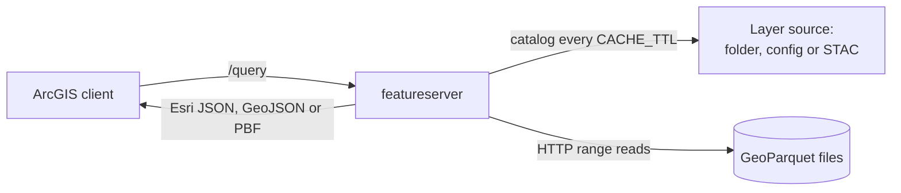

# cloud-native-geoservices

Serve cloud-native geospatial files as Esri GeoServices REST endpoints. ArcGIS Online Map Viewer,
Experience Builder, StoryMaps and ArcGIS Pro add the layers by URL, as they add any ArcGIS Server
layer.

| Service | What it serves | Built on |
|---|---|---|
| `featureserver` | GeoParquet files as FeatureServer layers | one Go binary |
| `imageserver` | COGs listed in STAC as ImageServers | Python on titiler and rio-tiler |

Both read the files in place, from a local disk or with HTTP range requests to a web server, CDN
or bucket. There is no database and no copy of the data to load. Both services are stateless, so
they can scale to zero on a platform such as Cloud Run.

The rest of this page is about `featureserver`. For `imageserver`, see [ImageServer](imageserver.md).

## Why use featureserver

- You keep one copy of the data: the GeoParquet file you already publish.
- Each request reads only the row groups, pages and columns that it needs. A small map tile on a
  large layer reads a few kilobytes, not the whole file.
- ArcGIS clients see a normal feature layer. They query it, draw it, identify features and show
  the symbols that you supply.
- When you replace a file, the server finds the new version and serves it. You do not restart it.

## How a request flows



1. The server finds the layer in its [layer source](layer-sources.md).
2. It reads the file footer, then uses the row-group statistics and the page index to find the
   rows that can match.
3. It reads the columns for those rows, applies `where` and the exact spatial test, and writes
   the response.

## Quick start

The repository has three sample GeoParquet files in `testdata/`. Serve them with Go 1.26.3 or
later:

```bash
git clone https://github.com/UGS-GIO/cloud-native-geoservices
cd cloud-native-geoservices
LAYERS_DIR=./testdata go run ./cmd/featureserver
```

Open `http://localhost:8080/`. The page lists each layer and its URL:

```text
{"layers": [{"topic": "qfaults", "render": "default", "title": "qfaults", "styled": false,
  "url": "http://localhost:8080/ugs/rest/services/qfaults/default/FeatureServer/0"}, ...]}
```

To serve your own data, set `LAYERS_DIR` to a folder of GeoParquet files. Then
[add a layer to Map Viewer or ArcGIS Pro](getting-started.md#add-a-layer-to-arcgis).

## Next steps

- [Getting started](getting-started.md): install, serve a folder, add a layer to ArcGIS.
- [Layer sources](layer-sources.md): folders, config files, STAC, and what a file must contain.
- [Configuration](configuration.md): every environment variable.
- [Querying](querying.md): the query parameters and how they differ from ArcGIS Online.
- [Performance](performance.md): how reads work, caches, memory and a CDN.
- [Deployment](deployment.md): Docker and Cloud Run.
- [ImageServer](imageserver.md): serve COGs as ArcGIS ImageServers.

## Who uses it

The [Utah Geological Survey](https://geology.utah.gov) maintains the project and runs it in
production for its geologic maps and data. Its public services under
`https://api.geology.utah.gov/ugs/rest/services/` are an example deployment.
