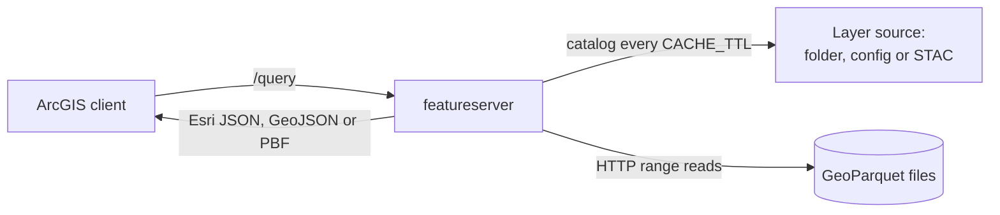

# cloud-native-geoservices

The `featureserver` command serves GeoParquet files as ArcGIS FeatureServer layers. ArcGIS Online
Map Viewer, Experience Builder, StoryMaps and ArcGIS Pro can add each layer by URL.

It is one Go binary. It reads the files in place, from a local disk or with HTTP range requests
to a web server, CDN or bucket. There is no database to run and no copy of the data to load.

## Why use it

- You keep one copy of the data: the GeoParquet file you already publish.
- Each request reads only the row groups, pages and columns that it needs. A small map tile on a
  large layer reads a few kilobytes, not the whole file.
- ArcGIS clients see a normal feature layer. They query it, draw it, identify features and show
  the symbols that you supply.
- When you replace a file, the server finds the new version and serves it. You do not restart it.

## How a request flows



1. The server finds the layer in its [layer source](layer-sources.md).
2. It reads the file footer, then uses the row-group statistics and the page index to find the
   rows that can match.
3. It reads the columns for those rows, applies `where` and the exact spatial test, and writes
   the response.

## Quick start

Serve a folder of GeoParquet files. Each `*.parquet` file becomes a layer.

```bash
go install github.com/UGS-GIO/cloud-native-geoservices/cmd/featureserver@latest
LAYERS_DIR=./data featureserver
```

Open `http://localhost:8080/`. The page lists each layer and its URL:

```json
{"layers": [{"topic": "faults", "render": "default", "title": "faults", "styled": false,
  "url": "http://localhost:8080/ugs/rest/services/faults/default/FeatureServer/0"}]}
```

Then [add the layer to Map Viewer or ArcGIS Pro](getting-started.md#add-a-layer-to-arcgis).

## Next steps

- [Getting started](getting-started.md): install, serve a folder, add a layer to ArcGIS.
- [Layer sources](layer-sources.md): folders, config files, STAC, and what a file must contain.
- [Configuration](configuration.md): every environment variable.
- [Querying](querying.md): the query parameters and how they differ from ArcGIS Online.
- [Performance](performance.md): how reads work, caches, memory and a CDN.
- [Deployment](deployment.md): Docker and Cloud Run.
