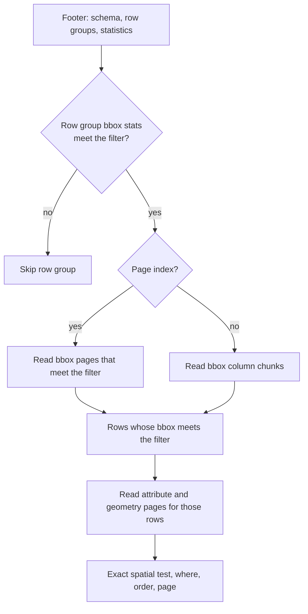

# Performance

The server reads only what a request needs from each file, keeps what it read in memory, and
refuses work it cannot finish rather than run out of memory.

## How a read works



1. The first read of a file fetches its last 256 KiB, which usually holds the whole footer. The
   footer gives the schema, the row groups and their statistics.
2. A spatial filter becomes a lon/lat box. Row groups whose `bbox_*` statistics miss the box are
   skipped.
3. Where the file has a page index, the server reads the column index of the bbox columns and
   skips the pages whose bounds miss the box. The bbox values that are left pick the rows.
4. The server reads the attribute and geometry columns for those rows only. Geometry is always
   read page by page. Other columns are read by page where the offset index places the pages,
   else as a whole column chunk.
5. For a count, ids or an extent, a row whose bbox is fully inside the query geometry passes
   without its geometry, and a row whose bbox is outside fails without it. Only the rest read
   geometry for the exact test.

Range requests that are within 64 KiB of each other are joined, up to 16 MiB each, and fetched
16 at a time. A range larger than 4 MiB is fetched in parallel parts. Each range is tried up to 4
times, with backoff, on a network error, a 5xx or a 429.

### File versions

Every cached entry is keyed by the file version: its `ETag`, or its `Last-Modified` time and
size. Once per `CACHE_TTL`, the server sends one `HEAD` request to check the version. When a file
is replaced, new reads use the new version and old entries age out of the caches.

When the file has a strong `ETag`, range requests send it in `If-Match`. If the file is replaced
during a read, the server gets 412, opens the new version and tries the request once again, so
one response does not mix two versions.

!!! warning
    The data server must support range requests. If it ignores the `Range` header and returns the
    whole file, the read fails.

## Overviews and simplification

At small scales, clients send `maxAllowableOffset`. The server uses it in two ways:

- It reads the coarsest [overview](layer-sources.md#overviews) that is still finer than the
  request, so a state-wide map does not read every vertex of the full data.
- It simplifies each geometry to the tolerance. The shape cache keeps the result per file and zoom
  step (the power of two at or below the tolerance), so all tiles of one zoom level share it and
  each feature is simplified once per zoom.

## Caches

| Cache | Variable | Keyed by |
|---|---|---|
| Page cache | `PAGE_CACHE_MB` | File version and byte range |
| Decoded values | `DECODED_CACHE_MB` | File version, column, row group or page |
| Shape cache | `SHAPE_CACHE_MB` | File version, zoom step, `feature_id` |
| Response cache | `RESPONSE_CACHE_MB` | ETag |

All caches drop the least recently used entries first. The layer list, the open file footers and
the render documents are kept for `CACHE_TTL` seconds.

### Response cache and ETags

Each response has a strong `ETag`. It is a hash of the layer source entry, the data file version,
the render document version, the path and the normalized query. A request with `If-None-Match`
that matches gets 304 Not Modified.

The response cache keeps each encoded response, compressed, by its ETag. A repeated GET is
answered from the cache before the server parses the parameters or reads any data.

GET and HEAD responses have
`Cache-Control: public, max-age={CACHE_TTL}, stale-while-revalidate={CACHE_TTL}` and
`Vary: Accept-Encoding`. Errors have `Cache-Control: no-store`.

## Compression

Responses of 1 KiB or more are compressed when the client accepts it. `COMPRESSION` sets the
codings that the server offers, most preferred first, from `gzip`, `br` and `zstd`. The default is
`gzip`.

The server picks the offered coding with the highest `q` value in the client's
`Accept-Encoding`. Ties go to the first one in `COMPRESSION`. If the client accepts none of the
offered codings but accepts gzip, the server uses gzip. With no `Accept-Encoding`, the response is
not compressed.

The response cache keeps each response in the first coding in `COMPRESSION`. A request for
another coding is transcoded once and then cached under its own ETag. Each compressed
representation has its own ETag, with the coding name added, for example `"…-gzip"`.

```bash
COMPRESSION=zstd,br,gzip
```

The zstd window is limited to 8 MiB, which browsers can decode.

A body over 16 MiB is sent with chunked transfer encoding and no `Content-Length`, because Cloud
Run refuses a larger HTTP/1 body that has one.

## Admission and 503

The server limits work at several points, so that a burst of requests cannot use all its memory.
When a request cannot start in time, it gets HTTP 503 with `Retry-After` and an Esri error body.
ArcGIS clients retry.

| Stage | Limit | Wait |
|---|---|---|
| Any request | `MAX_IN_FLIGHT` | None. `/healthz` is never refused. |
| Full-layer scan | `MAX_SCANS` | `SCAN_WAIT_MS` |
| Light query | `MAX_LIGHT` | `WORK_WAIT_MS` |
| Other query | `MAX_WORK` | `WORK_WAIT_MS` |
| Geometry read | `GEOMETRY_BUDGET_MB` | `BUDGET_WAIT_MS` |
| Heavy geometry read | `HEAVY_SLOTS` | `BUDGET_WAIT_MS` |

A light query is a deep-zoom tile (a box smaller than 0.5 degrees on each side, with no `where`
or statistics), an identify or lookup by fewer than 100 ids, or a count that the footer answers.
A full-layer scan is a `where`, statistics, distinct values or an order other than `feature_id`,
with no spatial filter and no ids. Cache hits use no slot.

A heavy request reads more than `HEAVY_MB` of compressed geometry. Only `HEAVY_SLOTS` of them
decode at once, so light requests always keep a CPU. One request can take at most three quarters
of the geometry budget.

## Memory sizing

At start, the server reads the cgroup v2 memory limit (`memory.max`) of its container. Each cache
and the geometry budget default to the smaller of a fixed size and a fraction of that limit:

| Setting | Fixed size | Fraction |
|---|---|---|
| `PAGE_CACHE_MB` | 128 MiB | 3% |
| `DECODED_CACHE_MB` | 512 MiB | 10% |
| `SHAPE_CACHE_MB` | 512 MiB | 15% |
| `RESPONSE_CACHE_MB` | 256 MiB | 6.25% |
| `GEOMETRY_BUDGET_MB` | 512 MiB | 12.5% |
| `MAX_IN_FLIGHT` | 2048 | 1 per MiB |

The Go heap gets a soft limit at 80% of the memory limit. Without a cgroup limit, the fixed sizes
apply.

For example, with 1 GiB of memory the defaults are about 31 MiB of page cache, 102 MiB of decoded
values, 154 MiB of shapes, 64 MiB of responses, a 128 MiB geometry budget and 1024 requests in
flight.

More memory makes warm requests faster, because more of each layer stays decoded. The shape
cache gets the largest share: a miss there costs a decode and a simplify. With every zoom's shapes
in the cache, a CPU answers about twice as many uncached tile requests. Set the
variables to give one cache more room. Most of the caches fill only with what clients ask for.

## Put a CDN in front

The responses are safe to cache: each has an ETag that changes when the data, the layer entry or
the render changes, and a `Cache-Control` max-age of `CACHE_TTL`. A CDN in front of the server
can answer repeated tiles and layer descriptions without reaching the server.

- Forward `Accept-Encoding`, or let the CDN compress. The server sends `Vary: Accept-Encoding`.
- Set `PUBLIC_URL` to the CDN URL, so `/` lists URLs that clients can reach.
- POST queries are not cacheable. ArcGIS clients use GET for most tile and identify requests.

Also put the data files on a CDN or a server near the service. Each cold read is one or more
range requests, so the latency to the data sets the time of a cold request.
